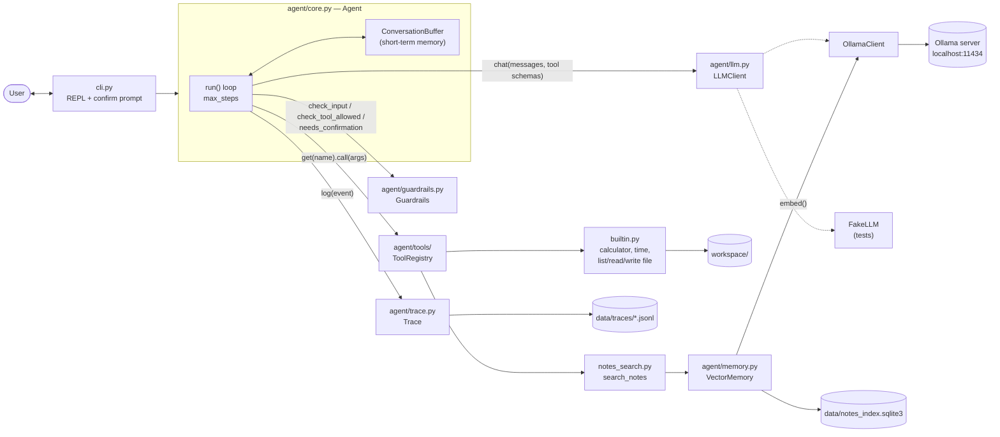
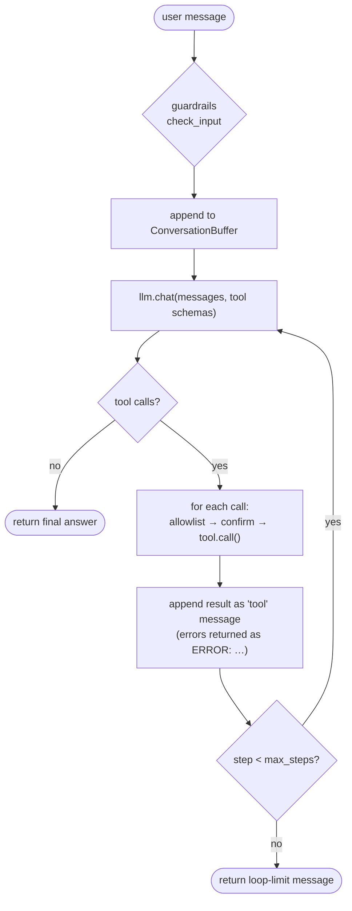

# Architecture: what this maps to in real systems

This document exists because the point of the project isn't really the
code — it's what the code teaches about how companies build agents in
production. Each section below takes one module and names the real
pattern, product, or published guidance it's a minimal version of.

## The system at a glance

How the modules fit together. `cli.py` wires everything up; `Agent`
owns the loop and the short-term memory, and everything else is
something the loop calls out to.

And one call to `Agent.run()`, step by step:

## The core claim this project is built on

Anthropic's engineering write-up on agent design (Dec 2024, still the
most-cited framing of this as of late 2026) draws one central
distinction worth internalizing before anything else: a **workflow** is
a system where LLM calls and tools are orchestrated through
*predefined code paths*, while an **agent** is a system where the LLM
*dynamically directs its own process and tool usage*, staying in
control of how a task gets done. Both are built from the same
primitive — an "augmented LLM" with retrieval, tools, and memory
attached — composed differently.

That same write-up is unusually candid about what actually works in
practice: "the most successful implementations weren't using complex
frameworks or specialized libraries," and the explicit recommendation
is to "find the simplest solution possible, and only increas[e]
complexity when needed." This project follows that advice literally —
`agent/core.py` is about 90 lines, and there is no framework underneath
it, on purpose. Reading it should demystify what LangGraph, CrewAI, or
the OpenAI Agents SDK are doing under their abstractions, because it's
this loop, with more configuration surface and more built-in
integrations wrapped around it.

The write-up also names the workflow patterns a lot of "agentic"
production systems actually are, before they ever need a full
autonomous loop: **prompt chaining** (a fixed sequence of LLM calls,
each processing the last one's output), **routing** (classify the
input, then send it down a specialized path), **parallelization**
(split into independent subtasks run concurrently, or run the same
task several times and vote on the results), **orchestrator-workers**
(one LLM plans subtasks at runtime and delegates them to others), and
**evaluator-optimizer** (one LLM generates, another critiques, looped
until the critic is satisfied). A lot of what gets marketed as "an AI
agent" in a company's product is actually one of these — cheaper,
faster, and easier to debug than a fully autonomous loop, because the
control flow is still code, not something the model decides at
runtime. This project centers on the fully autonomous pattern (section
below) because that's the hardest one to understand by reading about
it, and includes one small workflow for contrast (`agent/workflows.py`,
covered further down). If you're sizing up a real project, start by
asking whether a workflow pattern already solves it before reaching for
an agent loop.

## `agent/core.py` — the autonomous agent loop

This is the pattern the article calls out as appropriate only "when you
need flexibility and model-driven decision-making at scale," and warns
comes with real costs: higher token spend, since the model may take
several turns to reach an answer, and "the potential for compounding
errors," since each step can build on a mistake from the previous one.

The loop here is: send messages + tool schemas to the model; if it
returns tool calls, execute them and feed the *results* back as new
messages; repeat until it returns a plain answer or a guardrail stops
it. The "feed results back" step matters more than it looks — the
article calls this getting "ground truth from the environment," and
it's the entire reason tool calls beat the model just guessing: a
calculator result, a file's actual contents, or a tool's error message
is real information the model didn't have before, not more generated
text. Note that tool *errors* get returned to the model as a normal
tool message (`agent/core.py`'s `_execute_tool`), not raised as an
exception that kills the run — that's deliberate, so the model can
read the error and retry with corrected arguments or explain the
limitation, the same self-correction behavior you want from a human
calling a flaky API.

Every mainstream agent framework implements some version of this exact
loop: OpenAI's Assistants/Responses API run loop, Anthropic's tool-use
loop, LangChain's `AgentExecutor`, LangGraph's `ReAct` prebuilt graph,
CrewAI's task execution, and Microsoft's AutoGen conversational agents.
What differs between them is mostly the scaffolding around the loop —
state persistence, multi-agent message routing, built-in tool
integrations, streaming — not the loop's core shape.

## `agent/workflows.py` — the same tools, called by code

`NotesQAWorkflow` is a prompt chain with the tool calls fixed in code:
`get_current_time`, then `search_notes` on the question, then one model
call with **no tools offered** to write the answer, then `write_file`
to save it under `workspace/answers/`. The model's only job is the
language step. It can't skip retrieval, invent a file path, or spend
three round-trips deciding what to do, and if search finds nothing
relevant, code returns early without calling the model at all. That
early return is a stopping condition the agent loop can only *hope*
the model applies to itself.

The detail worth copying is that the workflow's tool calls go through
the same `run_tool` function in `agent/core.py` as the agent's do, so
the allowlist, the `write_file` confirmation and tracing all still
apply. "Our code made this call, not the model" is not a reason to
skip a guardrail. The guardrail exists because of what the action
does, not who chose it. Production systems mix the two styles all the time:
retrieval that always runs before an agent starts, or a
deterministic save/notify step after it finishes, wrapped around an
autonomous loop in the middle.

## `agent/skills.py` — instructions loaded on demand

A skill is a `skills/<name>/SKILL.md` file: `name` and `description`
frontmatter, then markdown instructions. This is the format of
Anthropic's Agent Skills, used by Claude Code, the Claude apps and the
Agent SDK, without the bundled scripts and resource files those
support. The idea it demonstrates is **progressive disclosure**. The
system prompt carries only each skill's name and description. When a
request matches, the model calls `load_skill`, and the full
instructions arrive as a tool result for that conversation only. You
can have many skills without every model call paying for all of their
text.

A skill is not a workflow. `skills/notes-answer/SKILL.md` describes
the same steps as `NotesQAWorkflow`, deliberately, so the two can be
compared. The workflow runs those steps because Python runs them. The
skill runs them only if the model reads them and decides to follow
them. A skill handles requests nobody anticipated and costs nothing to
add, but it is still the agent path: nothing enforces the steps, and
how well it works depends heavily on the model. In local trials,
`qwen2.5:7b-instruct` usually followed skills through, while `llama3.2`
often tried to call a skill's name as though it were a tool. That
prompted the explicit "skills are NOT tools" line in the system prompt
and the `enum` of skill names in `load_skill`'s schema.

One alternative worth knowing about is registering each skill as its
own zero-argument tool instead of a single `load_skill(name)`. It
matches what small models try to do anyway and did slightly better in
the same trials, at the cost of one tool schema per skill. The design
here stays with one loader tool, as Claude Code does, because the tool
list stays the same size however many skills you add.

## `agent/llm.py` — the model-agnostic client

Companies rarely call a model provider's SDK directly from inside
agent logic, for the same reason they don't hardcode a specific
database driver into business logic: it couples you to one vendor's
request/response shape, rate limits, and auth model. The usual fix is
a thin gateway layer — LiteLLM is the most common open-source example,
Vercel's AI SDK does the same for JS, and most larger companies have
an in-house equivalent — that normalizes "chat with tools" across
providers behind one interface.

`LLMClient` here is that interface (just a `.chat(messages, tools)`
method). `OllamaClient` is the real local implementation. `FakeLLM` is
the same interface played back from a script, and it's what every test
in `tests/test_core.py` uses — this is also exactly how you'd unit-test
an agent against OpenAI or Claude without spending API credits or
depending on network access in CI.

## `agent/tools/` — the tool registry

Every major tool-calling API — OpenAI function calling, Claude tool
use, Ollama's tool support, and Anthropic's **Model Context Protocol
(MCP)** — describes a tool to the model identically: a name, a
natural-language description, and a JSON Schema for the arguments. The
model never executes code; it only ever emits JSON matching that
schema, and your code decides what to do with it. `Tool.to_schema()`
in `agent/tools/__init__.py` produces exactly that shape, which is also
why a registry built this way is a short step from becoming an MCP
server later — the schema format is the same, only the transport
(stdio/HTTP instead of an in-process Python call) changes.

`agent/tools/builtin.py` is intentionally boring in a way that matters:
the calculator parses a restricted AST instead of calling `eval()`,
because a model's output is untrusted input, same as a web form field
— arbitrary `eval()` on it is a code-execution bug waiting for the
right adversarial prompt. The filesystem tools resolve every path and
verify it's still inside `workspace/` before touching disk. This is the
cheap, local version of what every production coding agent (Claude
Code, Devin, Cursor's agent mode) does in some form: the model gets a
*tool* with a defined blast radius, never a raw shell with your actual
filesystem.

## `agent/memory.py` — two different problems called "memory"

"Agent memory" conflates two engineering problems that get solved
differently in production.

Short-term memory is just the running conversation, trimmed so it
doesn't grow the prompt (and therefore cost and latency) without
bound. `ConversationBuffer` drops the oldest messages once over budget
— a real system would summarize the dropped turns instead of just
discarding them, which is the natural next upgrade if you extend this
project.

Long-term memory is retrieval: a persisted store of embedded text,
searched by similarity, so a model can answer questions about a large
corpus without that corpus ever occupying the context window at once.
`VectorMemory` does this with SQLite and a plain cosine-similarity
loop, which is a legitimate production pattern at small-to-medium
scale — companies reach for Pinecone, Weaviate, or pgvector mainly for
scale and concurrent-write characteristics, not because the underlying
retrieval math changes. This whole pattern is what's usually meant by
"RAG" (retrieval-augmented generation), and it's the backbone of most
company-internal knowledge-base and support agents, because it lets
you ground answers in a document set that didn't exist when the model
was trained, without fine-tuning anything.

## `agent/guardrails.py` — the unglamorous part that matters most

The article is blunt about this trade-off: autonomy "means higher
costs, and the potential for compounding errors," and the standard
mitigation it names explicitly is a "stopping condition (such as a
maximum number of iterations) to maintain control." `max_steps` in
`GuardrailConfig` is that control, and `test_guardrail_stops_infinite_tool_loop`
in `tests/test_core.py` proves it actually bounds a model that never
stops calling tools — read that test; it's the single most important
one in the project, because an ungoverned loop is the actual production
incident this whole module exists to prevent, not a hypothetical.

The tool allowlist is least-privilege applied to agents the same way
it's applied to any other service: narrower than "everything the model
could theoretically call." `confirm_before` is the cheap local stand-in
for the article's "pause for human feedback at checkpoints" guidance —
here it's a blocking yes/no prompt instead of a queueing system or an
approval UI, but the principle it encodes (don't let a model
unilaterally take an action you consider irreversible) is the same one
behind why production agents gate sending an email, charging a card, or
deleting a record behind an explicit approval step. The article also
notes a separate pattern worth knowing even though this project doesn't
implement it: a dedicated model instance screening inputs/outputs for
policy violations tends to perform better than asking one model to
both do the task and police itself — that's the role products like
Llama Guard, OpenAI's Moderation API, or a company's in-house classifier
play in a real pipeline.

## `agent/trace.py` — observability

When an agent misbehaves, the only way to actually debug it is to
replay exactly what the model saw, what it decided, and what each tool
returned, in order. That need is why LangSmith, Langfuse, Helicone, and
Arize Phoenix exist as products, and why OpenTelemetry standardized a
GenAI semantic convention for it: one span per LLM call, one span per
tool call, nested under a trace per request. `Trace` here is a minimal,
dependency-free version of the same idea — one JSON object per event,
appended to a `.jsonl` file. JSONL specifically because it's
append-only and crash-safe: if the process dies mid-run, every line
written so far is still valid JSON you can read back, which matters
for a loop that might run for many steps unattended. `pretty_print()`
is the local, five-minute equivalent of opening a run in one of those
products' web UI.

## What a real company would add that this project leaves out

This is deliberately not production-grade, and the gaps are
instructive. Multi-agent orchestration — a planner agent delegating to
specialist workers, the orchestrator-workers pattern from the article —
is a natural extension once a single agent's tool set gets too broad
for one system prompt to reason about well; LangGraph and AutoGen exist
mostly to make that coordination manageable. Real guardrails would
include an actual moderation model, not just a loop limit and an
allowlist, plus rate limiting and cost budgets per request. Real
observability would ship traces to a backend built for querying and
alerting on them, not a local file you read by hand. Real memory would
summarize instead of truncate, and would likely use a managed vector
database once the corpus outgrows "fits comfortably in SQLite." And a
real deployment would run behind retries, timeouts, and circuit
breakers around the model call itself, since a production system has
to survive a provider having a bad minute. None of that changes the
shape of `agent/core.py` — it changes what sits around it, which is
the actual lesson: the loop is the easy 10%.
